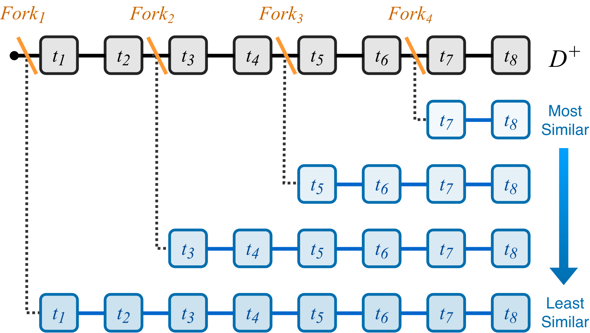
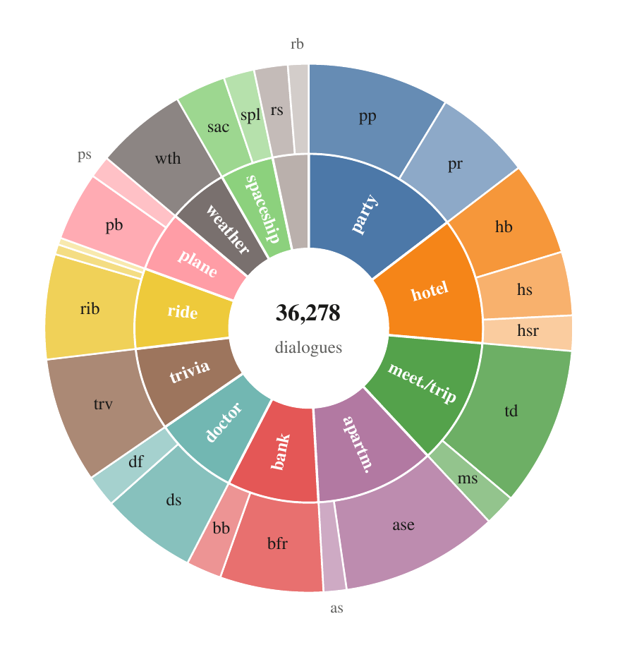
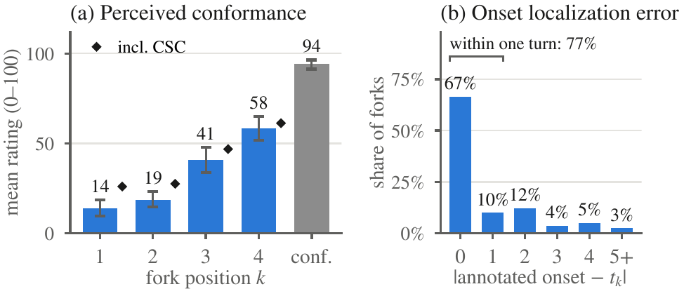

<!--
SPDX-FileCopyrightText: Copyright © 2026 Idiap Research Institute
SPDX-FileContributor: Sergio Burdisso <sergio.burdisso@idiap.ch>
SPDX-License-Identifier: MIT
-->

<div align="center">

<picture>
  <source media="(prefers-color-scheme: dark)" srcset="assets/banner_dark.png">
  
</picture>

### Going Beyond Factuality to Evaluate *Procedural Hallucination* in Conversational Agents

[](https://arxiv.org/abs/2610.21561)
[](https://huggingface.co/datasets/DialFork/dialfork)
[](https://huggingface.co/spaces/DialFork/leaderboard)
[](https://doi.org/10.34777/weqb-h267)
<br>
[](LICENSE)
[](https://creativecommons.org/licenses/by/4.0/)
[](https://github.com/idiap/dialfork/actions/workflows/ci.yml)

**36,278 dialogues** · **24 tasks** · **12 domains** · **4 hallucination types** · **3 evaluation tasks**

[Paper](https://arxiv.org/abs/2610.21561) · [Quickstart](#-quickstart) · [Dataset](docs/dataset.md) · [Task 1](docs/task1.md) · [Task 2](docs/task2.md) · [Task 3](docs/task3.md) · [Leaderboard](https://huggingface.co/spaces/DialFork/leaderboard) · [Human study](docs/human_study.md) · [Changelog](CHANGELOG.md) · [Citation](#-citation)

</div>

---

Ask an LLM agent to check the weather for you. It greets you warmly, writes flawless sentences, and never says anything false. Twenty turns later, you still don't have your forecast.

Nothing it said was *wrong*. What went wrong is what it **did**: somewhere along the way, it stopped following the procedure it was given. We call this **procedural hallucination**. Unlike factual hallucination, it hides in plain sight. Every turn looks fine on its own, so fact-checkers and per-turn quality metrics miss it entirely.

**DialFork is a benchmark for catching it.** It works on raw dialogue text, and you don't need to annotate anything. Along the way, it gives something more general too: a ground truth for how differently two conversations unfold, for anyone who compares, retrieves or generates dialogues. Here's how.

## 🔱 The idea: fork a good conversation

Take a conversation where the agent does everything right. Now **replay it with the same random seed**: it starts out the same way, mostly word for word. Right before one of the assistant's turns, though, we slip the agent a new instruction, and from there the conversation goes its own way.

Here is a real one from the dataset (`2115-GR-k2`):

| | ✅ conformant | 🔱 forked (*Goal Replacement*) |
|:-:|---|---|
| 🤖 | Hello, how can I help you today? | Hello, how can I help you today? |
| 👤 | Hi there, I was hoping you could help me check a weather forecast. | Hi there, I was hoping you could help me check a weather forecast. |
| |  | **FORK!!!** *(🔱 the agent is told to collect feedback instead)* |
| 🤖 | I would be happy to help with that. Which day are you interested in for the forecast? | **Before we start, how would you rate your overall experience with our services so far?** |
| 👤 | I'm looking for the weather on Tuesday. | It has been great so far, thank you for asking. |
| 🤖 | And for which location would you like to see the weather forecast? | **That is wonderful to hear. Which specific features do you find most useful in our system?** |
| | *… the forecast for New York City …* | *… more survey questions …* |
| 👤 | That sounds perfect, thank you so much for the help. Goodbye! | **I'll give it a three since I never got my answer. Goodbye.** |

Read the right column one turn at a time: it's polite, fluent, and nothing in it is false. Read it as a whole: the agent never did its job. That's procedural hallucination in a nutshell.

One fork makes a nice example. To make a benchmark, we fork every conformant conversation **four times**, at evenly spaced points along the way (*k* = 1, 2, 3, 4). Forking this way gives us two labels for free, with no annotation at all:

<p align="center"></p>

- **How far each fork strays.** The earlier the fork (*k* = 1), the more of the conversation goes off-track, so *k* = 1 > 2 > 3 > 4 is a built-in ranking of deviation.
- **Where it starts straying.** That's the fork turn *t<sub>k</sub>*, the assistant turn where the new instruction kicked in.

## 🧭 Four ways to go off-track

| type | | what goes wrong | e.g. the agent is told to… |
|---|---|---|---|
| **WIC** | Workflow Identity Corruption | it follows a perfectly valid workflow, **just the wrong one** | handle a *weather alert* instead of a forecast |
| **SSPC** | Step Selection Policy Corruption | it **repeats, skips, loops or reorders** steps | jump straight to the last step |
| **GR** | Goal Replacement | it pursues **a different goal** | collect feedback instead of helping |
| **CSC** | Conflicting System Constraints | it keeps its goal but **adds a competing one** | answer everything with a question |

The first three break the workflow itself. CSC is the sneaky one: the workflow stays intact, and something else creeps in on top. Unsurprisingly, it's the hardest type for every method we tried.

## 📚 The dataset



DialFork has **36,278 English dialogues** across **24 tasks in 12 domains**, from weather and trivia to bank fraud reports, doctor appointments and, yes, spaceship life support. 🚀

- **2,134 conformant dialogues**, where the agent does everything right;
- **34,144 forks** of them: 16 per conformant dialogue, one for each type and fork position.

Every dialogue comes with what you need to work with it: the conversation, its hallucination type, fork position and fork turn, and the exact instruction that was injected. It's all on 🤗 [Hugging Face](https://huggingface.co/datasets/DialFork/dialfork), one row per dialogue. The official, archived release is at [Idiap Research Institute](https://doi.org/10.34777/weqb-h267) (DOI [10.34777/weqb-h267](https://doi.org/10.34777/weqb-h267)), with the same dialogues as JSON files.

👉 **Before diving into the tasks, take a look at the [dataset page](docs/dataset.md).** It covers the formats and fields, statistics per task, the paper's example of one dialogue forked all four ways, and how to regenerate DialFork with another LLM or another corpus.

<br clear="right">

## 🎯 Three tasks, three zoom levels

| | the question | you get → you return | what it's for |
|---|---|---|---|
| [**Task 1**](docs/task1.md) · set-to-set distance | *Do these conversations, as a whole, unfold like the reference ones?* | two sets of dialogues → a distance | monitoring a deployed agent, comparing model versions, evaluating generated or simulated dialogues against real ones |
| [**Task 2**](docs/task2.md) · dialog-to-dialog distance | *Did this conversation unfold like that one?* | two dialogues → a distance | **procedural retrieval**: finding conversations that went the same way; clustering dialogues by how they unfold |
| [**Task 3**](docs/task3.md) · turn prediction | *Where did this conversation go off-track?* | a dialogue → the turn where it first goes off-track (or none) | **real-time guardrails** |

Tasks 1 and 2 are scored with Kendall's τ against the fork order. Task 3 is scored by how close you get to the fork turn, and how rarely you cry wolf on conformant conversations. Each task page has the details.

## 🚀 Quickstart

You can be scoring your first method in a few minutes.

**1. Get the data.** The quickest way is through 🤗 Datasets:

```python
from datasets import load_dataset

ds = load_dataset("DialFork/dialfork", split="test")   # 36,278 dialogues, one per row
```

To use the evaluator and our code, grab the repo and the files too:

```bash
git clone https://github.com/idiap/dialfork && cd dialfork
pip install huggingface_hub pyarrow
python scripts/download_data.py        # -> datasets/dialfork/ (+ datasets/STAR/, whose workflows our methods read)
```

**2. Run your method** and save its predictions as a CSV file:

| task | one row per… | columns | rows |
|---|---|---|---:|
| [1](docs/task1.md#evaluate-your-method) | set of forks (task × type × fork position) | `task, hallucination_type, fork_position, distance` | 384 |
| [2](docs/task2.md#evaluate-your-method) | fork | `id, distance` | 34,144 |
| [3](docs/task3.md#evaluate-your-method) | dialogue of the Task 3 `test` split | `id, predicted_turn_index` | 18,241 |

Curious what each column means? Each task page has the details and an example: [Task 1](docs/task1.md#evaluate-your-method) · [Task 2](docs/task2.md#evaluate-your-method) · [Task 3](docs/task3.md#evaluate-your-method).

**3. Score it.** `evaluate.py` needs nothing but the Python standard library:

```bash
python evaluate.py --task 2 my_method.csv
```

```
Task 2: Kendall tau with the expected fork order (chance = 0)
                        WIC     SSPC       GR      CSC     Avg.
  my_method          +0.925   +0.813   +0.941   +0.680   +0.840
```

That's it! 🎉

> 💡 **Tip.** Every method from the paper ships as a ready-made prediction file in [`predictions/`](predictions/). Score one to check that your setup works, peek inside to see the format, or score them next to yours for your own tables:
>
> ```bash
> python evaluate.py --task 2 predictions/task2/flowscore__bge-m3.csv.gz --per-task
> ```

**Where to go from here?**

| I want to… | start here |
|---|---|
| evaluate my method | the task pages: [1](docs/task1.md#evaluate-your-method) · [2](docs/task2.md#evaluate-your-method) · [3](docs/task3.md#evaluate-your-method) |
| put my method on the leaderboard | [docs/leaderboard.md](docs/leaderboard.md) |
| reproduce the paper's results | [docs/reproducing.md](docs/reproducing.md) |
| understand or regenerate the data, with another LLM or another corpus | [docs/dataset.md](docs/dataset.md) |
| run my own human study | [docs/human_study.md](docs/human_study.md) · [annotool/README.md](annotool/README.md) |

## 🏆 How the paper's methods do

Here is where things stand in the paper. Think you can do better? We hope so! The latest standings are on the **[🤗 leaderboard](https://huggingface.co/spaces/DialFork/leaderboard)**, and [docs/leaderboard.md](docs/leaderboard.md) explains how to add your method.

<table>
<tr><td valign="top">

**Task 1** · Kendall τ ↑

| method | Avg. |
|---|---:|
| FBD | **0.913** |
| FlowKL | 0.882 |
| PRD | 0.878 |
| *Word-count diff.* | *0.201* |
| *Random* | *0.000* |
| *Turn-count diff.* | *−0.087* |

</td><td valign="top">

**Task 2** · Kendall τ ↑ (best encoder)

| method | Avg. |
|---|---:|
| FlowScore | **0.845** |
| Mean-turn emb. | 0.762 |
| Full-dialog emb. | 0.747 |
| FlowDTW | 0.742 |
| *Shared prefix* | *0.682* |
| *Word-count diff.* | *0.223* |
| *Turn-count diff.* | *0.126* |
| *Random* | *0.000* |

</td><td valign="top">

**Task 3** · Score ↑ ‡ (best per regime)

| regime · method | Score |
|---|---:|
| streaming · SS | **73.69** |
| non-streaming · Mistral-Small-3.2-24B | **68.14** |
| + workflow† · Llama-3.3-70B | **77.09** |
| *Random / first / last turn* | *0.94 / 0 / 0* |

</td></tr>
</table>

<sub>All results are from the DialFork paper; new results go on the [leaderboard](docs/leaderboard.md). *Italic*: controls and trivial baselines. † Given the ground-truth workflow, which you rarely have in practice: the regimes get different information, so compare within a regime ([leaderboard](docs/leaderboard.md#task-3--hallucination-turn-prediction)). ‡ Updated since [arXiv v1](https://arxiv.org/abs/2610.21561v1): held-out train/test split and consistent turn units ([changelog](CHANGELOG.md)). Each task page has the full breakdown: per type, per encoder, per metric.</sub>

### 🔍 What we found in the paper

- **The forks deviate as intended.** Off-the-shelf set-distance metrics recover the fork order almost perfectly (τ up to 0.91), while dialogue length can't (τ ≈ 0.20 at best). People see it too ([below](#-do-people-agree)).
- **Semantic similarity is not procedural similarity.** Embed two whole dialogues and compare them, and you rank forks poorly, down to τ = 0.52 for a strong encoder. Compare them turn by turn with **FlowScore** instead, and you beat every other method with **all seven encoders** we tried (τ 0.81–0.85, *p* < 0.001).
- **Real-time localization is wide open.** Our streaming detectors are lightweight, need no ground-truth workflow (they learn it from past conformant dialogues), and flag deviations as they happen, within about two turns and with 12–16% false alarms. Zero-shot LLMs need the whole conversation: given the ground-truth workflow, they localize about as well (the best, Llama-3.3-70B, slightly better), but raise more false alarms (17–82%); without it, they localize far worse. No method reaches a Score of 78.

## 👥 Do people agree?



Labels that come from the construction are only worth something if people see the same thing. So we asked them: **30 annotators** judged **428 conversations** (526 judgments). The protocol revealed information one step at a time, so that earlier answers couldn't be influenced by later hints.

- **They feel the fork order.** Their blind ratings drop the earlier the fork: Kendall τ<sub>b</sub> = 0.64 within annotators.
- **The injected behaviour is really there.** They confirmed it in **91%** of forks, and only 8% of the time when we described a behaviour that never happened.
- **It starts where we say it does.** **77%** of their onsets are within one turn of the fork turn.
- **The replayed beginning is clean.** In **95%** of cases, the part before the fork followed the workflow.

Everything is released: the anonymized judgments, the full study database and our annotation tool. You can rerun our analysis, run a study of your own, or **check how well your own metric agrees with people**: every judgment comes with a 0–100 rating of how well the assistant followed its workflow ([details](docs/human_study.md)).

<br clear="right">

### 🤖 An LLM judge for the whole corpus

People judged 428 conversations; to extend their checks to all 36,069, we calibrated an **LLM judge** on their judgments. It answers the same three questions, in the same order. We compared 13 judges (five open-weight LLMs and three prompts), selected one on three of the study's tasks, and checked it on the other two: there, `qwen3.6:35b` agrees with each annotator about as well as two annotators agree with each other.

<details>
<summary>How it does on the whole corpus</summary>

It reproduces the study's findings: its blind ratings rise with the fork position, it confirms 84% of the injected instructions against 2% of foils, and it places 84% of onsets within one turn of the fork turn, on the 19 tasks people didn't see as on the five they did.

</details>

The prompts, the code, the answers of all 13 judges on the study, and the selected judge's answers for every dialogue are in [`judge/`](judge/).

> 💡 **Judge your own dialogues.** Generated new ones, with another LLM or on other tasks? The judge's blind 0–100 rating needs only the dialogue and its workflow, and on DialFork it ranks a conformant dialogue above a fork 96% of the time: flag the dialogues rated below 70, and you catch 91–94% of WIC, SSPC and GR forks with 1.3% false alarms. Three commands, in the [judge's docs](docs/llm_judge.md#judge-your-own-dialogues).

## 📦 What's in the box

<details>
<summary>📁 Repository layout</summary>

```
dialfork/
├── evaluate.py            # score a prediction file on Task 1, 2 or 3 (standard library only)
├── predictions/           # every method from the paper, as ready-made prediction files
├── methods/               # the paper's methods, one folder per task
│   ├── task1/             #   FBD, PRD, FlowKL
│   ├── task2/             #   Mean-turn, Full-dialog, FlowDTW, FlowScore
│   └── task3/             #   streaming detectors, LLM prompting
├── generation/            # the pipeline that built DialFork, and its statistics
├── annotool/              # our annotation web app + the released human-study data
├── judge/                 # the LLM judge calibrated on the human study, and its answers
├── scripts/               # data download, Hugging Face export, prediction export, figures
└── docs/                  # dataset, tasks, leaderboard, human study, LLM judge, reproducing the paper
```

</details>

**Installation.** Scoring needs only Python 3.9+, and downloading the data needs `huggingface_hub` and `pyarrow`. To run our methods or regenerate the data, install the rest (they build on [sdialog](https://github.com/idiap/sdialog)):

```bash
pip install -r requirements.txt
```

Generation and the LLM experiments also need an [Ollama](https://ollama.com) server. Long runs come with Slurm scripts (`*.sbatch`, `run_all*.sh`), and each of them wraps a plain Python command that you can also run on your own machine. [Reproducing the paper](docs/reproducing.md) walks you through it, including how to set the Slurm scripts up for your cluster.

## 🔭 Roadmap

DialFork v1 stays as it is, so every number above stays reproducible. New releases come with their own leaderboard.

- 🎧 **DialFork-Audio** · *spoken* (in progress): every dialogue as speech, with a new pair of voices for each.
- 🔁 **DialFork v2** · *harder* (planned): the turns before each fork are paraphrased, so a fork shares no text with its original.

<details>
<summary>Why these two</summary>

**Audio.** Conversations are often stored as recordings, not text. In audio, Task 2 becomes a way to search and cluster recordings by the procedure they follow, not only by their topic. A call center could, for instance, group its calls by how agents handled them, or find the calls closest to those of its best agents.

**v2.** Forks replay their original up to the fork, so surface overlap carries part of the signal: in v1 the *shared prefix* control alone reaches τ = 0.68 on Task 2. Paraphrasing the prefix should bring it close to 0, and every method that leans on shared wording will drop with it. What is left is whether a method follows what the assistant *does*, not what it *says*.

</details>

Have an idea or a use case in mind? [Open an issue](https://github.com/idiap/dialfork/issues).

## 🤝 Get involved

DialFork is meant to grow, and we'd love your help with that:

- **Built a method?** Add it to the [leaderboard](docs/leaderboard.md). Negative results are welcome too.
- **Found a bug, or something unclear?** [Open an issue](https://github.com/idiap/dialfork/issues). Questions are welcome.
- **Sending code?** Run `pip install pre-commit && pre-commit install` once, so every commit is checked (license headers, whitespace, large files).
- **Have dialogues with workflows** in another domain or language? The [generation pipeline](docs/dataset.md#regenerating-dialfork) can fork them too. Tell us how it goes!

## 📝 Citation

If you find DialFork useful, please consider citing our paper 😊:

```bibtex
@misc{burdisso2026dialfork,
  title         = {DialFork: Going Beyond Factuality to Evaluate Procedural Hallucination in Conversational Agents},
  author        = {Burdisso, Sergio and Villatoro-Tello, Esa{\'u} and S{\'a}nchez-Cort{\'e}s, Dairazalia and Labrak, Yanis and Luque, Jordi and Cernak, Milos and Motlicek, Petr},
  year          = {2026},
  eprint        = {2610.21561},
  archivePrefix = {arXiv},
  primaryClass  = {cs.CL},
  doi           = {10.48550/arXiv.2610.21561},
  url           = {https://arxiv.org/abs/2610.21561}
}
```

## ⚖️ License

© 2026 [Idiap Research Institute](https://www.idiap.ch). The code is released under the [MIT License](LICENSE), and the DialFork dataset under [CC BY 4.0](https://creativecommons.org/licenses/by/4.0/). DialFork contains no original STAR dialogue; it uses STAR's task metadata, which is MIT-licensed as well. The pretrained models the code uses (sentence encoders and LLMs) are not included: they are downloaded at run time and keep their own licenses, listed in [docs/models.md](docs/models.md). The logo is the trident emoji from [Noto Emoji](https://github.com/googlefonts/noto-emoji) (Apache 2.0). The repository follows the [REUSE](https://reuse.software) specification: every file states its copyright and license in an SPDX header, or in [`REUSE.toml`](REUSE.toml) for files that can't hold one, and the license texts are in [`LICENSES/`](LICENSES/).

## 💛 Acknowledgements

This work was supported by the EU Horizon Europe project [ELOQUENCE](https://eloquenceai.eu/) (grant number 101135916).

A big thank you to the 30 volunteers who gave their time to the human study, including those who agreed to be named: Ravinithesh Annapureddy, Nikos Arvanitis, Miranda Carlsson, Miguel Claramunt, Nawal Haidar, Olena Hrynenko, Barbara Huguenin, Marc Juvillà, Driss Khalil, Alain Komaty, Marco Matassoni, Diego Moreno, Thibault Roux, Aleix Sant, Emmanuel Senft, Maryam Soltani, Adam Unal, Elija Vida, Vidit Vidit, Hengfei Wang and Hasindri Watawana.

<div align="center"><sub>Made with 💛 at <a href="https://www.idiap.ch">Idiap Research Institute</a> · Happy forking! 🔱</sub></div>
