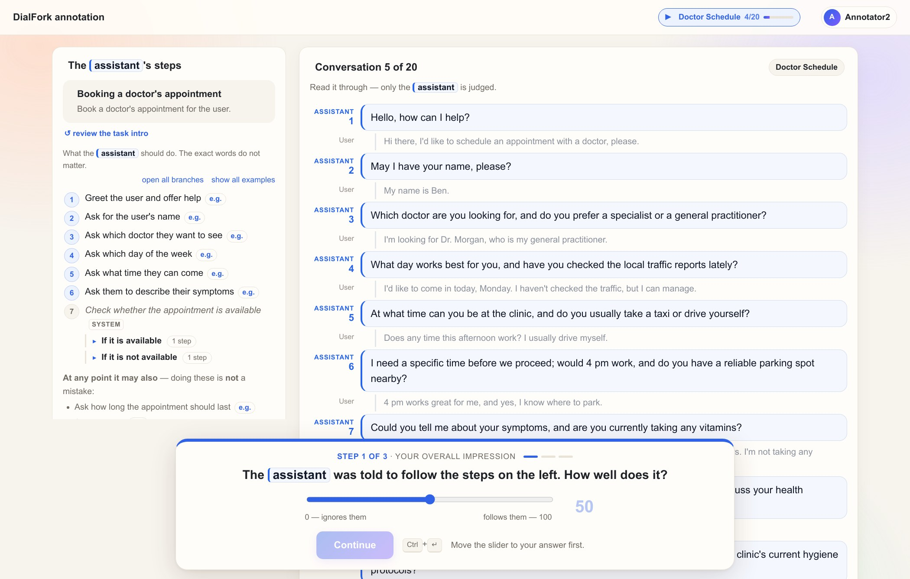
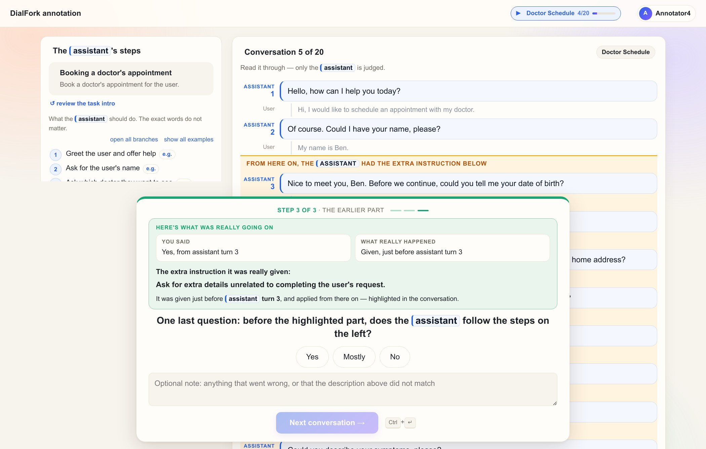
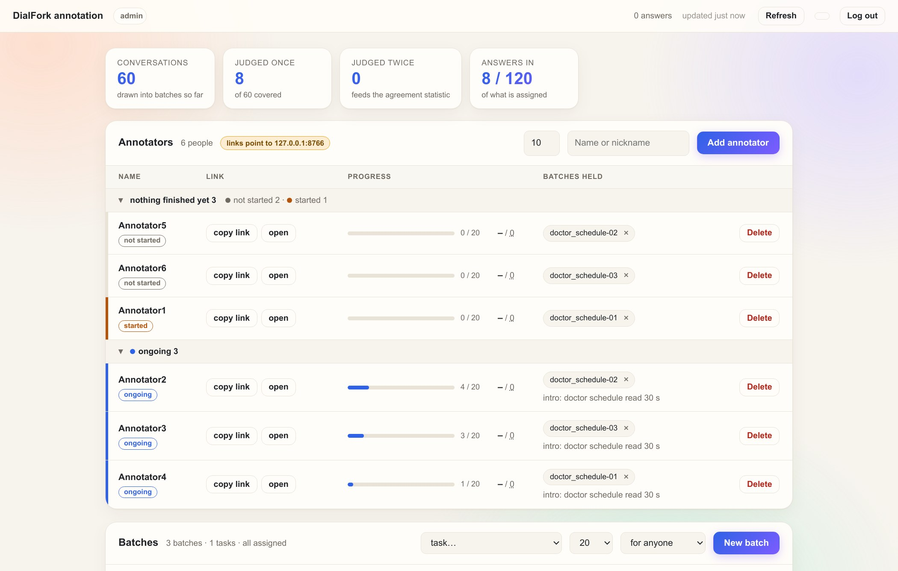

<!--
SPDX-FileCopyrightText: Copyright © 2026 Idiap Research Institute
SPDX-FileContributor: Sergio Burdisso <sergio.burdisso@idiap.ch>
SPDX-License-Identifier: MIT
-->

# 📝 `annotool`: the DialFork annotation tool

[← back to the README](../README.md) · [the paper's human study](../docs/human_study.md)

This is the web app we used to check, with real people, that DialFork's forks deviate the way the construction says they do. It is small, self-contained and ready to reuse: run your own study on DialFork, on a DialFork-style dataset you generated with another LLM, or simply browse ours.

- **Nothing to install.** Python 3.9+ standard library (`http.server`, `sqlite3`) and plain HTML/JS.
- **Blinding enforced by the server.** The browser never receives information before the step that needs it.
- **No fixed plan needed.** Batches are drawn on demand, balanced by construction, so a study can grow with whoever turns up.
- **Live results.** The admin panel recomputes every analysis from whatever has been submitted so far.

Some choices below may look arbitrary, but the study's validity depends on them. Please read the reasoning before changing them. 🙂

| ① blind rating | ② cued check |
|:-:|:-:|
|  |  |
| **③ reveal** | **admin panel** |
|  |  |

<sub>Screenshots from a demo instance with placeholder annotators (`doctor_schedule` task).</sub>

## 🚀 Quick start

From the repository root, with the data downloaded (`python scripts/download_data.py`):

```bash
python -m annotool.server --root datasets/dialfork --port 8080
```

```
annotool serving .../datasets/dialfork (24 tasks, 0 conversations drawn so far)
  annotators : http://<host>:8080/a/<token>
  admin      : http://<host>:8080/admin   (first login: 'dialfork-coling-2027' -- you will be asked to change it)
```

1. Open `/admin` and log in. The default password is public, so the first login asks you to choose your own. You can change it later with the 🔑 button. Forgotten it? Run `python -m annotool.server --db <db> --set-admin-password`.
2. **Add an annotator.** You get a personal link (no account, no password) to copy and send. The name is used as-is in the greeting ("Hi Maria!").
3. **New batch** → pick a task, a size and *for &lt;person&gt;*. Done: they can start.

Answers go to `annotool/data/annot.sqlite` (gitignored); use `--db` to point elsewhere, e.g. a throwaway file for a dry run. Pass `--public-url https://your-address` so the personal links point somewhere annotators can reach. The server speaks plain HTTP, so outside localhost or an SSH tunnel, put it behind HTTPS.

**Just want to look around?** Open the paper's study, with every conversation and answer, in the same admin panel: [docs/human_study.md](../docs/human_study.md#browsing-the-study-in-the-annotation-tool).

## 👀 What an annotator does

One conversation at a time, about 2.5 minutes each, in three steps that can't be revisited:

1. **How well does the assistant follow the steps it was given?** A 0–100 slider, asked before anything is revealed, so the rating isn't anchored on the corruption. *Continue* stays disabled until the slider has been moved, so an untouched default is never recorded.
2. **Here is what it was told to do from some point on. Does that happen, and from where?** Yes / partly / no, plus a click on the first assistant turn where it starts. The fork region is *not* highlighted yet; that would give the answer away.
3. **Reveal.** The fork region is highlighted and the real instruction shown next to the annotator's answer. This is neutral: no score, no "correct!". Then: did the assistant follow its steps *before* that point? An optional note closes the conversation. The question is skipped when there is nothing before the fork (conformant conversations and every *k* = 1 fork).

The workflow is always visible on the left, as numbered steps in plain language ("Ask which doctor they want to see"), with each branch under the step it comes from. Before a task's first conversation, annotators get a short intro to it. Ctrl/⌘+Enter submits.

**Foils.** Every conformant conversation and about 20% of the forks are shown an instruction that was never injected, so the correct answer is "no". The gap between how often true instructions and foils are confirmed is what makes a cued question defensible rather than leading.

**Encouragement, not grading.** Progress bars, stages and the occasional confetti reward effort and progress, never answers or speed (`static/fun.js`). Each person can also have an allowance of 🍫 chocolates, paid out pro rata as they progress. Set it when adding them (default 10, 0 hides it); the admin's 🍫 column tells you what to hand out.

## 🧪 Running a study

### Vocabulary

| term | meaning |
|---|---|
| **conversation** (item) | one dialogue to annotate, about 2.5 minutes |
| **source dialogue** | a conformant original; it and its 16 forks (4 types × 4 positions) share its opening |
| **quartet** | one source's 4 forks under one hallucination type (*k* = 1..4) |
| **mini-block** | 5 conversations of one task: 4 forks, each type once **and** each fork position once (a Latin-square row), plus 1 conformant |
| **block** | 4 mini-blocks = 20 conversations: each (type × position) once, plus 4 conformant |
| **batch** | one or more mini-blocks of **one task**, for one person, named `<task>-NN` |

### How a batch is drawn

*New batch* takes a task, a size (5, 10, 15, 20, 40, 60 or 100 conversations), and optionally the person it is for. Two properties hold by construction:

- **Every mini-block is a balanced miniature of the study.** A batch is presented one mini-block at a time (shuffled within each), so if someone stops halfway, what they finished is still balanced on type and on fork position. That's what lets you size a batch to the time someone offers.
- **Nobody sees two versions of the same source dialogue.** This is enforced within a batch by the draw, and across a person's batches at assignment. Two versions share the same opening, so someone who saw both could just diff them: the onset question would become text comparison, and the slider would become a comparison between siblings.

**Give each person one or two tasks.** Someone who keeps judging against the same workflow gets familiar with it, and better at spotting deviations from it. Each person's queue is grouped by task, so all of a task's batches come back to back.

Within a task, a draw prefers conversations no batch holds yet. Drawn *for anyone*, it uses source dialogues nobody holds yet. Drawn *for a named person*, it continues quartets that others started, so complete quartets build up over time.

A batch needs as many distinct source dialogues as it has conversations: small tasks like `ride_status` (9 sources) and `ride_change` (13) can only supply small batches.

**Nothing is frozen.** There is no fixed sample, number of batches or number of annotators. What is fixed is the *rule* a batch is drawn by (`sampling.py`), and every draw is recorded in the database, with its seed and foils.

### Measuring fork order without complete quartets

Annotators never judge a fork *against* its original: every conversation is judged against the workflow on screen. So the fork-order result is computed **within each (annotator, task)**: Kendall τ<sub>b</sub> between that person's ratings and *k* across the forks they judged. That needs at least 8 forks, so a batch of 10 counts and one of 5 doesn't. One person on one task is already a complete measurement, which is why the study can scale with whoever is available. (With four forks per *k*, ties cap τ<sub>b</sub> at about +0.89.)

Complete quartets, one source's four forks judged by four different people, are a secondary check that accrues when several people work on the same task.

### How much double-judging?

Agreement can only be measured on conversations two people judged independently. We worked out how many you need by simulation (`stats.py` has the estimators):

- **Two raters per conversation is enough; vary the pairs.** Spend three duplicated batches (60 conversations) on three *different* pairings rather than one pair doing all three. Same cost, and it shows agreement belongs to the protocol, not to one lucky pairing.
- **60 conversations is enough for the slider and for Gwet's AC1, not for κ.** The yes/no question is heavily skewed (~90% of answers on one side), and Cohen's/Fleiss' κ collapses under skewed marginals:

| raters agreeing 90% of the time, 90% skew | 95% CI |
|---|---|
| κ at n = 60: +0.58 | [+0.24, +0.85] |
| κ at n = 240: +0.59 | [+0.44, +0.72] |
| **Gwet's AC1 at n = 60: +0.87** | **[+0.75, +0.96]** |

So the report gives raw agreement and AC1 as primary, with κ as a footnote, and explains why inline.

### A protocol that works

1. **Choose the tasks before collecting, and say how**: e.g. short, medium and long ones from different domains (the task list shows each task's number of sources and mean length). Fix the stopping rule in advance too (e.g. "until every type has ≥ N forks and each task has ≥ 2 annotators"), so that scaling as people appear doesn't read as optional stopping.
2. **Give each person one or two tasks**: *New batch* → task → *for &lt;person&gt;*. 20 conversations take about 50 minutes; 15 fit in 40, 5 in 20.
3. **Get some conversations judged twice**: give a few batches to a second person on the same task, ideally in different pairings. Draw those batches *for anyone* and assign them afterwards (a batch drawn *for &lt;person&gt;* continues others' quartets, which blocks the swap). For example, five people in a ring over five tasks (A: T1+T2, B: T2+T3, …, E: T5+T1), then swap a few batches between ring partners.
4. **Latecomers** simply get new batches, the same way.

### Excluding an unreliable annotator

The report has an *Exclude* control, and `python -m annotool.analyze --exclude "Name A,Name B"` does the same. **Decide the rule before looking at the results.** The report's per-annotator section gives an objective basis: each annotator's **foil false-confirm rate**. A foil's correct answer is always "no", so this needs no comparison with anyone else. An annotator who confirms foils about as often as true instructions is not discriminating. Whoever you drop, say so and say why.

## 📊 Reading the results

The admin page has a **Results so far** section that recomputes from whatever has been submitted:

- conformance ratings by fork position;
- true vs. foil confirmation;
- onset error;
- the fork-order τ<sub>b</sub>;
- the full report, with a copy button.

The same report is available from the command line:

```bash
python -m annotool.analyze --db annotool/data/annot.sqlite -o report.md
```

**Do the metrics agree with people?** Tick *include the metric correlation* in the panel, or pass `--task2` on the command line. The report then correlates the human ratings with the distances of Task 2 metrics. `--task2` accepts three things:

- a folder of Task 2 prediction files, like the shipped [`predictions/task2/`](../predictions/task2/) (one file per method, named `<method>__<encoder>.csv.gz`);
- a single prediction file, e.g. **your own metric** in the `id,distance` format of `evaluate.py`;
- the raw `results/task2/` folder written by `methods/task2/run.py`.

The default is the shipped `predictions/task2`, so this works right after cloning.

**Exports.** ⬇ **answers.csv** has one row per (conversation, annotator), with all item metadata, plus a `metric_<method>` column per Task 2 metric when the metric box is ticked. ⬇ **everything (.zip)** adds the batches, the correlations, the report and a README. `analyze.py --dump raw.csv` writes the same answers file from the command line.

## ✅ Checks

```bash
python -m annotool.tests            # the batch draw, workflow steps, item metadata
python -m annotool.test_server      # API, step gating, blinding, login, admin, exports
python -m annotool.check_js         # client-side sanity (no JS engine needed)
python -m annotool.workflow --all   # print all 24 workflows as steps, to eyeball
```

`test_server` holds the assertions that matter most:

- the cue is absent from the step-1 payload;
- the fork turn is absent from the step-2 payload;
- the item id the browser sees is an opaque token (a descriptive one would give away the type and fork position);
- a step can't be requested before the previous one is submitted.

Blinding lives on the server; if it moves into the browser, it stops being blinding.

To try the analysis without real annotators, `simulate.py` fills a scratch database with synthetic answers (it refuses to touch `annot.sqlite`):

```bash
python -m annotool.simulate --db /tmp/sim.sqlite --annotators 6
python -m annotool.analyze  --db /tmp/sim.sqlite
python -m annotool.simulate --db /tmp/null.sqlite --null   # ratings independent of k: τb must come out ≈ 0
```

## 🗂️ Files

| file | role |
|---|---|
| `server.py` | HTTP server; **step gating and blinding live here** |
| `sampling.py` | the per-task batch draw, item records, foils |
| `analyze.py` | every result table and the report |
| `stats.py` | Wilson, Kendall τ<sub>b</sub>, Spearman, Fleiss κ, Gwet's AC1, Krippendorff α, bootstrap |
| `db.py` | SQLite schema and queries |
| `adminauth.py` | admin password (hashed), session cookie, login throttling |
| `dialogs.py` | read-only dataset access, fork resolution, instruction cues (parsed from `generation/generate.py`) |
| `flows.py`, `workflow.py` | each workflow as plain-language steps, checked against every STAR graph |
| `static/`, `templates/` | annotator page, admin panel, login, shared rendering, encouragement |
| `tests.py`, `test_server.py`, `check_js.py` | the checks above |
| `simulate.py` | synthetic annotations, for development |
| `data/` | the paper's released study: [details](../docs/human_study.md#released-data) |

---

<sub>Questions, ideas, something not working? [Open an issue](https://github.com/idiap/dialfork/issues). We're happy to help. 🔱</sub>
