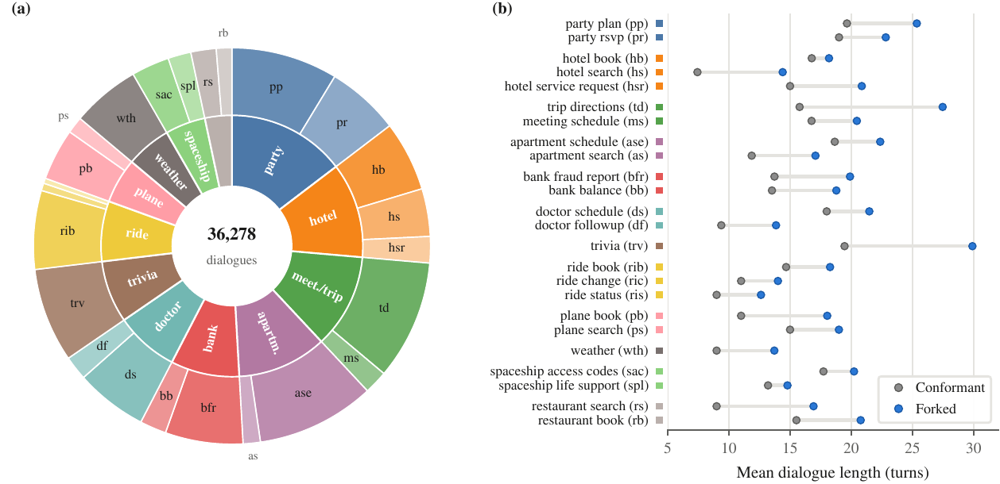

<!--
SPDX-FileCopyrightText: Copyright © 2026 Idiap Research Institute
SPDX-FileContributor: Sergio Burdisso <sergio.burdisso@idiap.ch>
SPDX-License-Identifier: MIT
-->

# The DialFork dataset

[← back to the README](../README.md)

Welcome to the data! DialFork has **36,278 English task-oriented dialogues**: 2,134 *conformant* dialogues, in which the assistant follows its workflow, and **34,144 forks** of them, in which the assistant drifts away from it. They cover the 24 tasks and 12 domains of [STAR](https://github.com/RasaHQ/STAR), from weather and trivia to bank fraud reports, doctor appointments and, yes, spaceship life support. 🚀

<p align="center"></p>

- [How it is built](#how-it-is-built)
- [Hallucination types and variants](#hallucination-types-and-variants)
- [Getting the data](#getting-the-data)
- [Formats](#formats)
- [Statistics](#statistics)
- [Regenerating DialFork](#regenerating-dialfork)
- [Credits](#credits)

## How it is built

Every dialogue is a role-play between two LLM agents (`Gemma4-31B`): a **system** agent given the task's workflow, and a **user** agent given the role-play instructions that STAR's human participants received. No original STAR dialogue is included; only STAR's metadata is used.

**Conformant dialogues.** The system agent is asked to follow the workflow, and nothing else interferes.

**Forks: seeded replay.** To fork a conformant dialogue, the same simulation is replayed with the same random seed, so its opening is reproduced: mostly word for word, sometimes slightly reworded, since decoding was not fully deterministic in our generation setup. A welcome side effect: matching the opening word for word does not always give the fork away. Either way, the assistant follows the same workflow up to the fork, as the human study confirms. Right before a chosen assistant turn *t<sub>k</sub>* (the **fork turn**), an extra instruction is slipped into the system agent's context: follow another workflow, pursue another goal, skip steps, and so on. From there on, the conversation unfolds naturally under that instruction, and the user agent reacts to it as a user would.

Each conformant dialogue is split into four segments, and a fork starts at each one (**fork position** *k* = 1…4). Forking happens for each of the four hallucination types, so every conformant dialogue has **4 types × 4 positions = 16 forks**. Two labels come for free with the construction:

| label | meaning | used by |
|---|---|---|
| fork position *k* | an earlier fork leaves less of the conversation conformant, so it should be *more* deviant: *k*=1 > *k*=2 > *k*=3 > *k*=4 | Tasks 1 and 2 |
| fork turn *t<sub>k</sub>* | the assistant turn where the deviation starts | Task 3 |

Neither label depends on the generator's wording. A human study with 30 annotators confirmed that they match what people perceive ([human study](human_study.md)).

## Hallucination types and variants

The four types follow a simple workflow model with a goal, a workflow (states and actions), and a policy that picks the next step. Each type corrupts a different part of it:

| type | short | what is corrupted | variants |
|---|---|---|---|
| Workflow Identity Corruption | **WIC** | the workflow: the agent follows a valid workflow, but the wrong one (task confusion, prompt injection) | 24 substitute workflows (e.g. `weather_alerts`, `trivia_score_reporting`) |
| Step Selection Policy Corruption | **SSPC** | the policy: steps are repeated, skipped, looped, inverted or randomized | 5: `step_repeat`, `step_skip`, `step_loop`, `step_invert_order`, `step_randomize` |
| Goal Replacement | **GR** | the goal: the agent pursues a qualitatively different one | 6: e.g. `goal_collect_feedback`, `goal_educate_user`, `goal_register_user` |
| Conflicting System Constraints | **CSC** | the goal is kept, but a competing objective is added on top | 6: e.g. `constraint_always_question`, `constraint_confirm_everything` |

WIC, SSPC and GR break the workflow itself. CSC keeps every part of it, goal included, and adds a competing behaviour on top. That makes CSC the most subtle type and, consistently, the hardest for every method.

### One dialogue, four ways to go off-track

Here is the example from the paper's appendix: the same `apartment_schedule` conversation (`dialog_id` 532), forked at *k* = 2 with each of the four types. All five versions share these opening turns:

> 🤖 Hello! How can I help you today?<br>
> 👤 Hi, I'm looking to schedule a viewing for an apartment.<br>
> 🤖 I would be happy to help you with that. Could you please tell me your name?<br>
> 👤 My name is Mark.

Then comes the fork, right before the assistant's third turn. Here is what the assistant says next in each version:

| version | the assistant's next turn | what happened |
|---|---|---|
| ✅ conformant | Nice to meet you, Mark. Which apartment are you interested in viewing? | the next workflow step |
| **WIC** (`apartment_search`) | I can help you find a place using filters like the number of bedrooms, price, floor, balcony, … | it switched to *searching* for apartments, a different task |
| **SSPC** (`step_invert_order`) | Is there any specific message you would like me to include for the letting agency? | it jumped to the workflow's last step |
| **GR** (`goal_suggest_alternatives`) | Nice to meet you, Mark. Would you be interested in looking at some managed co-living spaces instead? | it steers him toward other options instead |
| **CSC** (`constraint_confirm_everything`) | Just to be sure, is it correct that your name is Mark? | still on track, but it double-checks everything along the way |

Notice the CSC fork: right after Mark confirms his name, it asks which apartment he wants, just as it should. Its workflow is intact, which is what makes CSC the subtlest type.

## Getting the data

**Hugging Face** ([`DialFork/dialfork`](https://huggingface.co/datasets/DialFork/dialfork)), the easiest way: one Parquet row per dialogue, in a single `test` split.

```python
from datasets import load_dataset

ds = load_dataset("DialFork/dialfork", split="test")   # all 36,278 dialogues
row = ds.filter(lambda r: r["id"] == "2115-GR-k2")[0]
print(row["fork_assistant_turn"], row["turns"][:row["fork_turn_index"] + 1])   # the opening, up to the first forked turn
```

**As files** (what the scripts in this repository read):

```bash
python scripts/download_data.py              # -> datasets/dialfork/ and datasets/STAR/
python scripts/download_data.py --no-star    # DialFork only
```

It downloads the Hugging Face release and rebuilds the original folder tree byte for byte, plus `task3_splits.csv`. It also fetches STAR at a pinned commit, since the methods read its task workflows. Requires `pip install huggingface_hub pyarrow`.

**Official archived release** (Idiap Research Institute, DOI [10.34777/weqb-h267](https://doi.org/10.34777/weqb-h267), also on [Zenodo](https://zenodo.org/records/23527044)): the same 36,278 dialogues as one JSON file each, named by their `id` (e.g. `2115-GR-k2.json`), with a `metadata.csv` (one row per dialogue, the fields above, including `task3_split`) and `task3_splits.csv`. This is the permanent, archived copy; the Hugging Face copy is the same data in a more convenient format.

## Formats

### Hugging Face rows

| field | description |
|---|---|
| `id` | `<dialog_id>-conformant`, or `<dialog_id>-<TYPE>-k<k>` for a fork, e.g. `2115-GR-k2`. These are the ids that Task 2 and Task 3 prediction files use |
| `task3_split` | `train` or `test`: the [Task 3 split](#task-3-split) |
| `task`, `domain` | the STAR task (e.g. `weather`) and its domain |
| `dialog_id` | the source dialogue; a conformant dialogue and its 16 forks share it |
| `kind` | `conformant` or `fork` |
| `hallucination_type`, `hallucination_type_short` | e.g. `goal_replacement` / `GR`; empty for conformant dialogues |
| `variant_id` | the instruction that was injected (e.g. `goal_collect_feedback`) |
| `fork_position` | *k* in 1..4; empty for conformant dialogues |
| `fork_assistant_turn` | *t<sub>k</sub>*, the fork turn: 1-based, counting **assistant turns only** |
| `fork_turn_index` | the same turn as a 0-based position in `turns`. This is the value Task 3 asks to predict. (`turns[:fork_turn_index]` is the part before the fork) |
| `num_turns`, `turns` | the conversation, as a list of `{speaker, text}` |
| `dialog_json` | the complete original file (see below) |

### Folder tree

```
datasets/dialfork/
├── task3_splits.csv                           # the Task 3 train/test split: task, dialog_id, split
└── <task>/                                    # 24 tasks, e.g. weather/
    ├── originals/dialog_<id>.json             # conformant dialogues
    └── <hallucination_type>/                  # e.g. goal_replacement/
        └── n_hallucinations_4/
            └── fork_at_segment_<k>/           # k = 1..4
                └── dialog_<id>.json           # the fork of originals/dialog_<id>.json
```

Each file is an [sdialog](https://github.com/idiap/sdialog) `Dialog`: the turns, plus everything needed to reproduce it:

```jsonc
{
  "model": {"name": "ollama:gemma4:31b", "temperature": 1.3, "seed": 13, ...},
  "seed": 2157,                       // the seed shared by the original and its forks
  "id": 2115,
  "personas": {"System": {...}, "User": {...}},
  "turns": [{"speaker": "System", "text": "Hello, how can I help you today?"}, ...],
  "events": [...],                    // the full generation trace, injected instruction included
  "annotations": {
    "task": {"name": "weather", "domain": "weather", "graph": {...}, "replies": {...}},
    "hallucination_type": "goal_replacement",
    "variant_id": "goal_collect_feedback",
    "fork_assistant_turn": 2,
    "fork_turn_index": 2,
    "fork_segment": "2/4"
  }
}
```

## Task 3 split

[Task 3](task3.md) comes with an official `train`/`test` split (`task3_splits.csv`; the `task3_split` field on Hugging Face). Task 3 is scored on `test`, which `evaluate.py` does by default. Methods may learn only from the **conformant** dialogues of `train`, for example to learn the workflow, as the paper's streaming detectors do. The `train` forks and their labels must not be used to train a method (for tuning without the `test` split, see the [optional cross-validation note](task3.md#optional-tuning-with-cross-validation-on-train)): they would let it exploit regularities of the construction (evenly spaced fork positions, a finite pool of injected behaviours) that do not exist in deployment, where failures are not known in advance. Supervised methods that use them should be reported separately, as they are not comparable. The split is over **source dialogues**: a conformant dialogue and its 16 forks are always on the same side, since a fork replays its source before the fork turn (splitting individual files would leak test prefixes into training). Within each task, half of the source dialogues, chosen with a fixed seed, are in `test` (the larger half when the count is odd):

| split | source dialogues | dialogues |
|---|---:|---:|
| `train` | 1,061 | 18,037 |
| `test` | 1,073 | 18,241 |

The split is for Task 3 only. **Tasks 1 and 2** compare forks with their conformant reference, which is part of each task's input and never itself scored, so they use every dialogue; methods for them must not train on or tune with the labels.

`scripts/make_splits.py` defines the split (`--check` verifies a `task3_splits.csv` against it).

## Statistics

| subset | dialogues | % | mean turns | mean words |
|---|---:|---:|---:|---:|
| Conformant | 2,134 | 5.9 | 15.5 | 187 |
| WIC forks | 8,536 | 23.5 | 20.0 | 258 |
| SSPC forks | 8,536 | 23.5 | 19.3 | 187 |
| GR forks | 8,536 | 23.5 | 24.8 | 342 |
| CSC forks | 8,536 | 23.5 | 20.6 | 248 |
| **Total** | **36,278** | 100 | 20.8 | 255 |

In total: 756,126 turns and 9.2M words. The per-task tables (Tables 2, 3 and 7 of the paper) and a set of integrity checks (no missing, orphan or duplicate forks) come from:

```bash
python generation/stats.py              # add --latex or --markdown for paper-ready tables
```

## Regenerating DialFork

The full pipeline is in [`generation/`](../generation/). It uses [sdialog](https://github.com/idiap/sdialog) and an Ollama server, and needs a GPU: the released dataset took about 33 GPU-days on V100s. For installation and running it on a Slurm cluster, see [Reproducing the paper](reproducing.md).

Write to a new folder: `datasets/dialfork/` holds the downloaded data.

```bash
python generation/generate.py -o datasets/dialfork_regenerated                         # all 24 tasks
python generation/generate.py --tasks weather hotel_book -o datasets/dialfork_regenerated   # some of them
python generation/generate.py -m ollama:qwen3.6:35b -o datasets/dialfork_qwen          # with another generator
bash   generation/run_all.sh -o datasets/dialfork_regenerated                          # one Slurm job per task
```

| option | meaning |
|---|---|
| `-o, --output-path` | output root; one folder per task is created inside (default `datasets/dialfork`) |
| `-t, --tasks` | tasks to generate (default: all) |
| `-m, --model` | the generator LLM, as an [sdialog](https://github.com/idiap/sdialog) model string (default `ollama:gemma4:31b`, the paper's) |
| `-n, --hallucinations-per-dialog` | fork positions per dialogue (default 4) |
| `--ignore-done` | re-process tasks that already have a `DONE.txt` marker |
| `--overwrite-existing` | regenerate dialogue files that already exist (otherwise only missing ones are generated) |

A finished task gets a `DONE.txt` marker, and re-runs skip it. To regenerate a finished task from scratch, pass both `--ignore-done --overwrite-existing`. Generation is resumable at the file level, so an interrupted job can simply be resubmitted.

Because the pipeline only needs a workflow and role-play instructions, it can produce a DialFork-style benchmark with **another generator LLM** (`-m`), or for **another corpus** that provides workflow metadata.

### Publishing it on Hugging Face

`scripts/export_hf.py` turns a dataset folder into the Hugging Face format used for DialFork: Parquet shards, one row per dialogue, plus the dataset card (`scripts/hf_card.md`) with its images. `scripts/download_data.py` can then rebuild the exact folder tree from it.

```bash
# full export: Parquet shards + dataset card -> hf_export/
python scripts/export_hf.py -i datasets/dialfork_regenerated -o hf_export --repo-id <user>/<dataset>

# only the dataset card and its images (e.g. after editing scripts/hf_card.md)
python scripts/export_hf.py --card-only -o hf_export --repo-id <user>/<dataset>

# upload (huggingface_hub; log in first with `huggingface-cli login`)
huggingface-cli upload <user>/<dataset> hf_export . --repo-type dataset
```

`--card-only` counts the dialogues from the input folder, or from the Parquet files already in the output folder if the input is missing. Uploading again only sends the files that changed.

## Credits

The DialFork dataset is released under [CC BY 4.0](https://creativecommons.org/licenses/by/4.0/).

DialFork's dialogues are new, but the tasks, workflows and role-play instructions behind them come from [STAR](https://github.com/RasaHQ/STAR) (MIT license). If you use the data, please consider citing STAR as well:

```bibtex
@misc{mosig2020star,
  title         = {STAR: A Schema-Guided Dialog Dataset for Transfer Learning},
  author        = {Mosig, Johannes E. M. and Mehri, Shikib and Kober, Thomas},
  year          = {2020},
  eprint        = {2010.11853},
  archivePrefix = {arXiv},
  primaryClass  = {cs.CL}
}
```
---

<sub>Questions, ideas, something not working? [Open an issue](https://github.com/idiap/dialfork/issues). We're happy to help. 🔱</sub>
