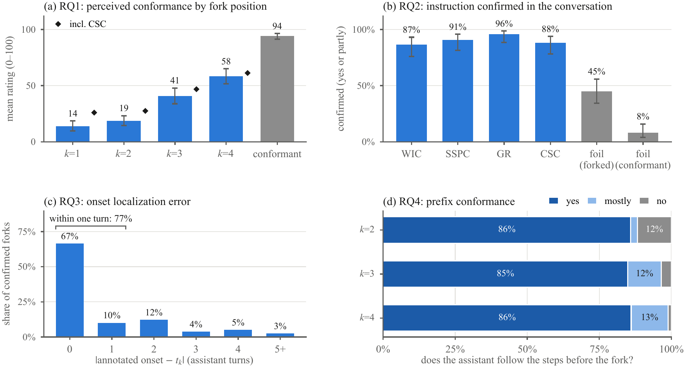
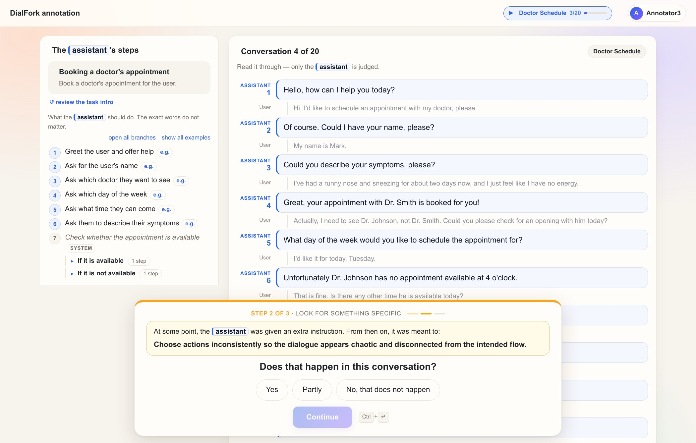

<!--
SPDX-FileCopyrightText: Copyright © 2026 Idiap Research Institute
SPDX-FileContributor: Sergio Burdisso <sergio.burdisso@idiap.ch>
SPDX-License-Identifier: MIT
-->

# Human validation

[← back to the README](../README.md)

DialFork's labels come from how the dialogues are built, not from annotation. The fork position *k* gives an order of deviation, and the fork turn *t<sub>k</sub>* gives where the deviation starts. That's convenient, but would people agree? We asked them: **30 annotators, 526 judgments of 428 conversations**, from five tasks spanning short to long dialogues (`weather`, `plane_book`, `bank_fraud_report`, `hotel_book`, `party_plan`).

<p align="center"></p>

| research question | label tested | result |
|---|---|---|
| **RQ1** Does fork position track perceived deviation? | fork position *k* (Tasks 1–2) | **Yes.** Blind 0–100 ratings rise with *k* (14 → 19 → 41 → 58, conformant 94); within-annotator Kendall τ<sub>b</sub> = 0.64 for the types that break the workflow (WIC, SSPC, GR) |
| **RQ2** Does the injected behaviour appear? | type and variant | **Yes.** Confirmed in 91% of forks (87–96% per type), against 8% for *foils* on conformant dialogues: cues naming a behaviour that never happened. On forks, a foil can partly match the deviation that is there (45%), yet the true instruction is still confirmed twice as often |
| **RQ3** Does it start at the intended turn? | fork turn *t<sub>k</sub>* (Task 3) | **Yes.** 67% exactly at *t<sub>k</sub>*, 77% within one turn |
| **RQ4** Is the part before the fork conformant? | seeded replay | **Yes.** 95% followed or mostly followed |

CSC keeps every step of the workflow, goal included, and adds a competing behaviour on top, so it is analysed separately in RQ1. Its forks are still clearly perceived as deviating: they are rated below a conformant dialogue by the same annotator in 87% of pairs. With CSC included, the ordering holds as well (markers in panel a). The full protocol, statistics, agreement and learning-effect checks are in the paper's last appendix.

## The protocol in brief

Annotators judge one conversation at a time, about 2.5 minutes each, in three steps that cannot be revisited. The task's workflow is always shown on the left as numbered steps in plain language.

<p align="center"></p>

1. **Blind rating.** *How well does the assistant follow its steps?* A 0–100 slider, asked before anything is revealed (RQ1).
2. **Cued check.** *At some point the assistant was given an extra instruction: here is what it was meant to do. Does that happen, and from which turn?* (RQ2, RQ3). Every conformant dialogue and about 20% of forks are shown a **foil** instead. Its correct answer is "no", so foils measure rubber-stamping.
3. **Reveal and prefix check.** The fork region is highlighted. *Before it, did the assistant follow its steps?* (RQ4). An optional note.

The server enforces the blinding. The browser never receives the cue before step 2, nor the fork turn before step 3.

## Released data

Both files are in [`annotool/data/`](../annotool/data/):

| file | what it is |
|---|---|
| `dialfork_human_judgments.csv` | one row per (conversation, annotator): 526 judgments of 428 conversations |
| `dialfork_human_study.sqlite` | the full study database, to open in the annotation tool: batches, assignments, every step of every answer |

Both are **anonymized**. Annotators appear as `Annotator01`…`Annotator31`: 31 volunteers were recruited, and one never started. Every timestamp is replaced by its rank, so only the order of events is kept.

**CSV columns**

| group | columns |
|---|---|
| what was shown | `item_id`, `ref` (task/type/k/dialogue id), `task`, `source_id`, `kind` (`fork` / `conformant`), `hallucination_type`, `variant_id`, `segment` (*k*), `fork_assistant_turn` (*t<sub>k</sub>*) |
| the step-2 cue | `cue_type`, `cue_variant`, `is_foil` (1 = the cue names an instruction that was never injected) |
| the answers | `slider` (step 1, 0–100), `appears` (yes / partly / no), `onset_sys_turn` (first assistant turn where the behaviour starts), `prefix_ok` (yes / mostly / no; empty when there is no pre-fork part), `note` (free text), `seconds` |
| metrics | one `metric_*` column per Task 2 method: its distance from the conformant original |

> 💡 **Does your metric agree with people?** Each judgment comes with a blind 0–100 rating of how well the assistant followed its workflow (`slider`). The `metric_*` columns hold the paper's Task 2 methods. Your own metric is one command away: score the forks in the Task 2 format of `evaluate.py` (`id,distance`), and let the report correlate them with the ratings:
>
> ```bash
> python -m annotool.analyze --db annotool/data/dialfork_human_study.sqlite --task2 my_metric.csv
> ```
>
> Pass `--task2 predictions/task2` instead to get the paper's methods side by side.

## Reproducing the analysis

```bash
python -m annotool.analyze --db annotool/data/dialfork_human_study.sqlite        # full report, RQ1-RQ4
python scripts/make_human_figure.py -a annotool/data/dialfork_human_judgments.csv \
       -o human_study.pdf                                                       # the figure (needs matplotlib)
```

## Browsing the study in the annotation tool

The admin panel shows every conversation exactly as the annotators saw it, next to the ground truth and everyone's answers, plus the report with its charts. The server writes to the database it opens (sessions, the admin password), so work on a copy:

```bash
cp annotool/data/dialfork_human_study.sqlite /tmp/dialfork_study.sqlite
python -m annotool.server --db /tmp/dialfork_study.sqlite --root datasets/dialfork --port 8080
```

Open <http://localhost:8080/admin> and log in with `dialfork-coling-2027`. You will be asked to choose a new password. Then:

- **Compute report** gives the results per research question.
- **Annotators' notes** opens the conversation behind each note.
- Each batch lists its conversations.

The conversations are read from `datasets/dialfork/`, so download the data first.

## Running your own study

[`annotool/`](../annotool/) is a self-contained web app: Python 3.9+ standard library only, plain HTML/JS, no installation. It works with any DialFork-style dataset, for example one regenerated with another LLM:

- Batches are drawn on demand, balanced over types and fork positions (Latin squares), and foils are included.
- Annotators get personal links; there are no accounts.
- An admin panel shows progress, and results are recomputed live.

```bash
python -m annotool.server --root datasets/dialfork --port 8080   # then open /admin
```

See [`annotool/README.md`](../annotool/README.md) for the full guide (handing out work, double judging for agreement, exports) and the design rationale.

---

<sub>Questions, ideas, something not working? [Open an issue](https://github.com/idiap/dialfork/issues). We're happy to help. 🔱</sub>
